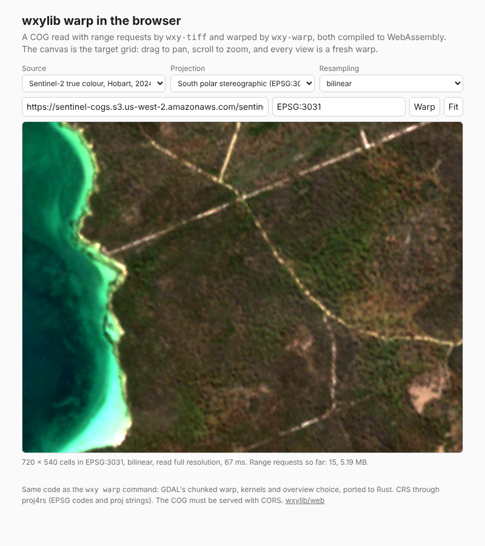
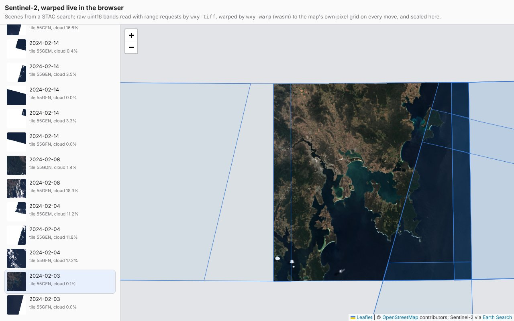
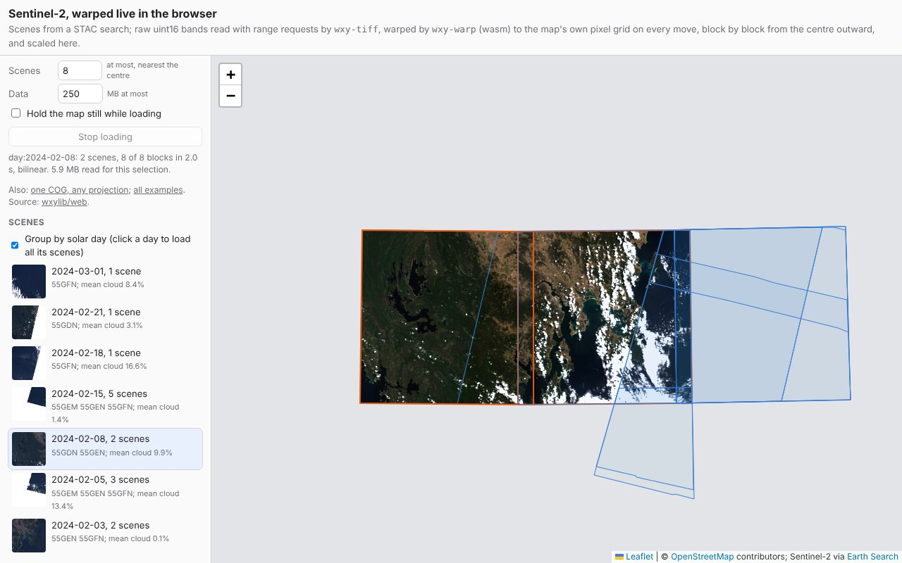
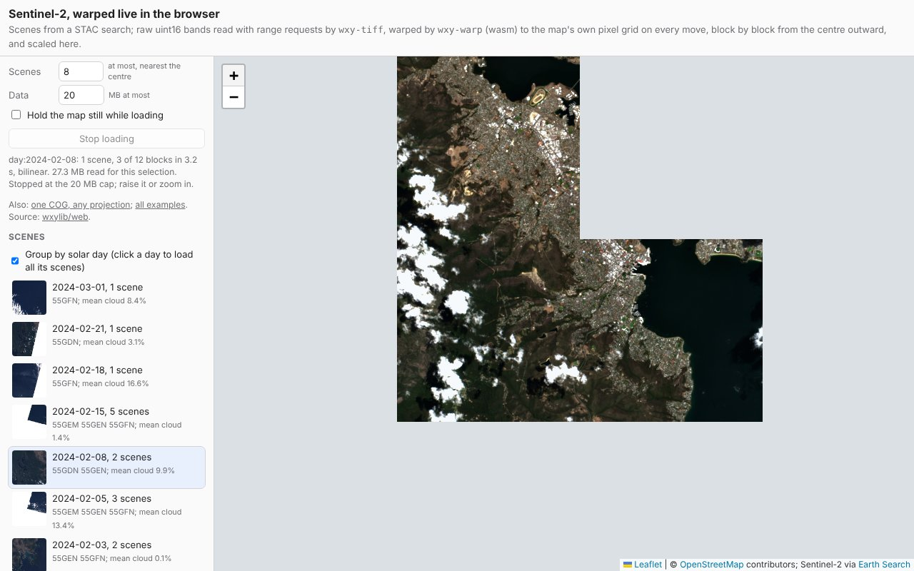
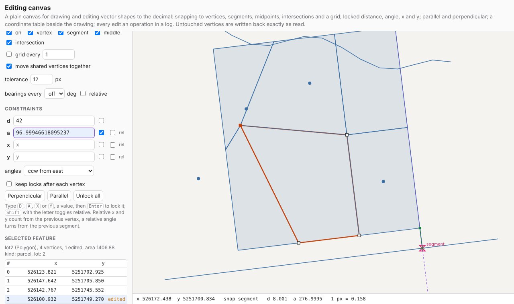
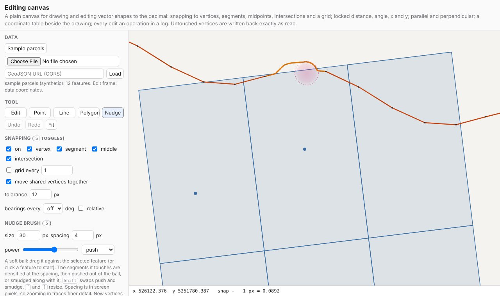
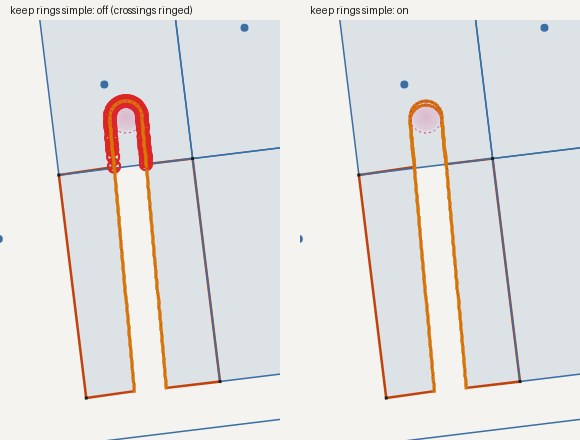

# wxylib/web

wxylib in the browser. A Cloud Optimized GeoTIFF is opened over HTTP range
requests by `wxy-tiff` and warped by `wxy-warp`, both compiled to
WebAssembly, onto the canvas. The canvas is the target grid: drag to pan,
scroll to zoom, and every view is a fresh warp with the same code the
`wxy warp` command runs (GDAL's chunked warp, kernels and overview choice).
Rendering is warping to a screen grid.


A Sentinel-2 true colour scene over Hobart (UTM 55S) on south polar
stereographic: 144 ms for the warp, five range requests (header, image
directories and the coarsest overview's tiles, 0.74 MB). Zoomed in, the
warp switches to full resolution as gdalwarp's `-ovr AUTO` would, and
fetches only the tiles the view touches:



## Sentinel-2 on a web map

The landing page (`www/index.html`, the Pages root) lists the examples.

`www/s2.html` browses Sentinel-2 L2A: a STAC search of the map view
(Earth Search, `sentinel-2-l2a`, dates and a cloud limit), footprints and a
scene list, and the chosen scene drawn from its raw uint16 band COGs. Each
of three bands is warped by `wxy-warp` onto the map's own Web Mercator
pixel grid (the part of the view the scene covers) whenever the map stops
moving; the page then turns them into colour: reflectance from the STAC
`raster:bands` scale (the offset is skipped when
`earthsearch:boa_offset_applied` says it is already removed), a black and
white point, and gamma. The sliders repaint without warping again. Band
sets: true colour, false colour, SWIR and agriculture; the 20 m bands are
warped onto the same grid as the 10 m ones.


Hobart at full resolution, 3 bands warped from UTM 55S to the map grid.
Zoomed out, the whole scene comes from the coarsest overviews (5 range
requests per band, 1.8 MB for all three):



With "Group by solar day" ticked, the list shows days instead of scenes
(UTC time shifted by the scene's longitude, so a pass at 23:58 UTC over
Tasmania counts as the next local morning). Clicking a day loads all its
scenes in view onto the map. Every load, one scene or a day, cuts the view
into 256 pixel blocks and warps them nearest the centre first (nearest
scene first within a block), three at a time, painting each as it lands.
Loading controls: at most N scenes (those nearest the centre), a cap on
the data read (the load stops there and says so), a Stop button, and
"Hold the map still while loading", which disables panning and zooming
until the load ends. Without the hold, moving the map abandons the load
and starts again from the new centre; the old picture stays until the new
one is done.



Blocks fill from the centre out; this load stopped at a 20 MB cap:



In these screenshots the basemap tiles and the STAC response were stubbed
(the build machine cannot reach them; the STAC items are the real ones from
the `sentinel-cogs` bucket). The band reads and warps are live.

Not yet: overlapping scenes are drawn over each other, not mosaicked by
a rule (latest, least cloud); the warp runs on the page's thread; and each
full-resolution view fetches whole 1024 by 1024 tiles (about 1.5 MB each
per band), so zooming in on a slow link is slow.

## GeoParquet, queried in the browser

`www/vector.html` runs SQL over remote GeoParquet with DuckDB (wasm) and
shows the result twice: as a table, and its `geometry` column (WKB) drawn
on the map. Click a row to find its feature, or a feature to find its row.
None of it is wxylib code. Vector access and query already exist (DuckDB,
DataFusion, geoarrow-rs; design m09, section 6), so this page shows the
piece wxylib hands vector work to rather than a new crate.

The default sources are Overture Maps buildings (512 files, about 230 GB)
and places (16 files, about 11 GB), latest release. Three levels of
pruning keep a view's query small:

1. the Overture STAC catalog gives each file's bbox, so only the files the
   view meets are opened (all 512 buildings footers would be 471 MB; the
   one file under central Hobart has a 1.5 MB footer);
2. DuckDB reads that footer and keeps only the row groups whose `bbox`
   column statistics meet the view;
3. within those, it fetches only the columns the query names.

A view of central Hobart's buildings then reads about 10 MB (measured
with pyarrow, footer included). The status line counts the requests and bytes DuckDB
makes. `{files}` and `{xmin}` to `{ymax}` in the SQL are filled in from
the source and the map view; a query without `{files}` runs as written,
and `?url=...` or `?sql=...` open one directly.

The URL box also takes a set of files: several URLs separated by spaces,
or a numbered range such as `ftw_global_{00000..00123}.parquet` (zero
padded to the first number's width). The first query over a set reads
every footer once for each file's bbox (the GeoParquet `geo` metadata),
kept in the browser after that, so later queries open only the files the
view meets, the job the STAC catalog does for Overture.

Choosing a preset moves the map to a place with its data (central
Hobart for Overture), the files' extents are drawn as dashed boxes once
they are known, and "Zoom to the results" frames the last result.


Not yet: DuckDB loads its Parquet reader as an extension from
extensions.duckdb.org on first use, which the build machine cannot reach,
so this page was tested here with the rendering, WKB decoding (identical
to shapely on Overture polygons), file pruning (against a stubbed STAC
catalog) and byte counting, and the reads above were measured with
pyarrow; the screenshot's rows are the real Overture rows for that view.
No basemap tiles in the screenshot for the same reason. Big polygons are
costly: Overture division areas put whole countries in a row group, and a
city view of them reads about 170 MB of geometry.

## A vector VRT, read in the browser

`www/vrt-vector.html` opens an OGR vector VRT (`OGRVRTDataSource` XML)
and draws the layers it describes from their sources over HTTP, with each
layer's features in a table. The XML is read by `www/ogrvrt.js` as GDAL's
OGR_VRT driver reads it (GDAL 3.12's `ogrvrtlayer.cpp` and
`ogrvrtdatasource.cpp` are the reference), for a subset of its elements:

- `OGRVRTLayer` with `SrcDataSource` (`relativeToVRT`), `SrcLayer`,
  `SrcSQL`, `FID`, `Style`, `GeometryType`, `LayerSRS`, `Field` (`name`,
  `src`, `type`; String when no type is given, as in GDAL), `SrcRegion`
  and the `Extent*` elements;
- `GeometryField` encodings Direct, None, PointFromColumns, WKT and WKB
  (bytes or hex), with `reportSrcColumn`, `SRS` and `SrcRegion` (the
  first geometry field only);
- `OGRVRTWarpedLayer` (`SrcSRS`, `TargetSRS`) and `OGRVRTUnionLayer`
  (`SourceLayerFieldName`, `FieldStrategy`, `PreserveSrcFID`, `LayerSRS`,
  `Field`), nested;
- `SrcSQL` as OGR SQL: `SELECT *` or a field list with `AS`, one layer,
  `WHERE` (AND, OR, NOT, comparisons, IN, BETWEEN, LIKE, ILIKE, IS NULL,
  arithmetic), `ORDER BY`, `LIMIT`, `OFFSET`; no functions or joins.

Sources, by file extension: GeoJSON, FlatGeobuf (through its spatial
index: only the features in the map view are fetched, with range requests,
and read again as the map moves), CSV (values are strings, as GDAL reads a
CSV without a `.csvt`) and GeoParquet (WKB; the first 20,000 rows).
`/vsicurl/`, `/vsis3/` and `/vsigs/` paths become https URLs. SRS: EPSG
codes from a short list (every UTM zone, the polar stereographics, the
Australian ones), WGS84 and OGC:CRS84, PROJ strings and WKT, by proj4js.
Anything else in a VRT is listed under Notes on the page rather than
dropped without a word, and so is a GDAL rule the page relaxes (a
`SrcLayer` that does not match a single-layer source is read anyway).


The examples, in `www/data/vrt`, use one or more of these each:
`antarctic.vrt` (two CSV layers: points from columns with OGR style
strings, and WKT lines in EPSG:3031), `countries.vrt` (Natural Earth
GeoJSON on GitHub, a `SrcSQL` filter, an FID field, three renamed fields),
`union.vrt` (a union of a layer and a warped layer), `countries-parquet.vrt`
(GeoParquet with a `SrcRegion`) and `uscounties.vrt` (FlatGeobuf read by
the view). `scripts/vrt_examples.py` writes their small sources.

Each example is checked against GDAL feature by feature (fields, values,
FIDs, geometry): `scripts/vrt_oracle.py` reads them with GDAL 3.12 (the
pyogrio wheels) into `scripts/vrt-oracle.json`, and `scripts/vrt-test.mjs`
reads them with `ogrvrt.js` and compares. Writing the examples against
GDAL found that there is no `AttrFilter` element in OGR_VRT (GDAL
ignores one without a word; `SrcSQL` is the way to filter), and that a union
layer reports a feature count of 0, so GDAL's own reader in pyogrio has to
use the Arrow path to see its features.

The format readers are other people's: flatgeobuf, hyparquet (with
hyparquet-compressors), proj4js and Leaflet, from jsDelivr and unpkg at
pinned versions. GDAL itself compiled to wasm (gdal3.js) would read every
VRT, but at tens of megabytes and without range reads of remote files;
the VRT is small XML, so the page reads it and hands each source to a
small reader that already exists. A layer can be downloaded as GeoJSON or
opened in the editing canvas (`edit.html`, for CRS frames such as polar
stereographic, which the web map here does not show).

Not yet: a nested VRT as a source, GeoPackage and shapefiles, more than
one geometry field, clipping to `SrcRegion`, SQL functions and the SQLite
dialect, and row group pruning by the view for GeoParquet. The map is Web
Mercator, so polar layers are drawn stretched; the jsDelivr `+esm`
builds were stood in for by local bundles of the same versions in the
tests here (the build machine cannot reach the CDNs).

## A multidimensional VRT, read in the browser

`www/mdim.html` reads a GDAL multidimensional VRT (`mdim.vrt`) the way
GDAL would, without GDAL. The default is the published GHRSST MUR v2 VRT
on source.coop (`ausantarctic/ghrsst-mur-v2/ghrsst-mur-v2.vrt`, 16.6 MB
of XML): five arrays of 8922 days x 17999 x 36000, 38,360 `<Source>`
elements, one daily COG each (ZSTD with Predictor=2, 512 tiles, five
overviews).

1. The VRT is fetched and parsed in plain JavaScript (`www/mdim-vrt.js`,
   no DOM beyond `DOMParser`): groups, dimensions, coordinate arrays
   (`RegularlySpacedValues`, `InlineValues`), and for each array its type,
   unit, nodata, scale, offset and sources (`SourceFilename`,
   `SourceBand` or `SourceArray`, `SourceTranspose`, `SourceSlab`,
   `DestSlab`). For GHRSST: 2.2 s to fetch, 2.4 s to parse.
2. The day picked on the slider is a destination index; the source whose
   `DestSlab` (and `SourceSlab` count, with `-1` in `SourceTranspose` as a
   new axis of length 1) covers it is the file to read. The page shows
   that `<Source>` element, and checks the VRT's x and y coordinates
   against the COG's own grid.
3. That COG is opened with range requests by `wxy-tiff` and warped onto
   the canvas by `wxy-warp` (the `Cog` class below), in any of five
   projections; the VRT's nodata, scale and offset turn the stored
   integers into degrees C.
4. A click reads one cell through the days either side (15 to 121): each
   day is another source, opened for one full resolution pixel, two range
   requests and about 180 kB each.


One view of a day reads the COG overview gdalwarp would pick (7 range
requests, 0.6 MB for the whole globe). GDAL itself, reading the same
view through the VRT, would read full resolution: an mdim VRT carries no
overviews. `?vrt=`, `?array=`, `?t=` (the index on the first axis) and
`?proj=` (`longlat`, `south`, `north`, `tas`, `moll`) open a view
directly; any multidimensional VRT whose sources are COG bands served
with CORS works. `/vsicurl/`, `/vsis3/` and `/vsigs/` names and paths
relative to the VRT are turned into URLs.

Not yet: sources that are netCDF or HDF5 arrays (`SourceArray`) are
listed but not read (the BRAN2023 page reads those from a byte table
instead). The whole source band is read, so a `SourceSlab` that selects
part of it, `SourceView` and derived arrays are not honoured (the page
says so when it meets one);
only the first axis is stepped, so a VRT with time and depth shows the
first depth. The parse holds the whole XML in memory; a VRT many times
larger would want a streaming parse or the store's flat refs table.

## An mdim-refs table, read in the browser

`www/bran.html` draws BRAN2023 `temp` from its byte table: every chunk is
a range request into the netCDF files on NCI's THREDDS server, inflated
and unshuffled in the page. With `?table=` it opens any mdim-refs/0.2
export (`arrays.json` plus `refs_<array>.parquet`, the form
`wxy_virtual::from_refs_table` reads), so the same page shows the
wxylib/fixtures tables straight from GitHub:

- [BRAN2023 temp, January 2010](https://wxylib.github.io/web/bran.html?table=https://raw.githubusercontent.com/wxylib/fixtures/main/mdimrefs/bran2023-temp-201001/)
- [OISST, September 1981](https://wxylib.github.io/web/bran.html?table=https://raw.githubusercontent.com/wxylib/fixtures/main/mdimrefs/oisst-198109/&array=sst)

The Parquet is read with hyparquet. `?array=` picks a referenced array
(else the first), `?target=` a `remap` target (else the first the table
names), and `?range=lo,hi` the colour stretch (default `-2,31`). Absent
chunks are drawn as fill; inline chunks (`data`) are decoded from the
table. Chunks must be one time and one level of a 4D int16 array, with
zlib and an optional shuffle. If a data host refuses the browser (no
CORS), the page says so and keeps drawing what it can. Checked against
GDAL on the three-day test table; THREDDS and NOAA's bucket were not
reachable from where this was written.

## What is in a VRT?

`www/vrt.html` explores any VRT: give it a URL, a `vrt://` string, or a
pasted document. It reads no pixels. It says:

1. What kind of VRT it is: classic raster, warped, derived bands (pixel
   functions), processed, pansharpened, multidimensional, vector, a
   `vrt://` string, or a tile index (a neighbour), and what that kind does.
2. What the document uses, as short facts: a mosaic, implicit resampling
   (SrcRect and DstRect of different sizes), fractional windows, source
   nodata, scaling, lookup tables, nested VRTs, archive members, driver
   prefixes, `vrt://` sources, declared or undeclared source sizes, pixel
   functions and their arguments, sources without a `SourceSlab` count.
3. Every element used, how often, where, and what it does (`www/vrt-dict.js`
   holds a sentence for each element, `vrt://` key and built-in pixel
   function, written after the reference documentation), and the whole
   document as a tree that builds as it is opened.
4. For a classic raster: the grid, the bands, the sources with each name
   parsed into its parts (`/vsi` chain, driver prefix and subdataset,
   `vrt://` options), a figure of where each source lands, and a read plan:
   for a window and buffer size, the source windows read, the whole pixels
   asked for, where they land, the operations on the way, through any
   nesting. "Read source headers" reads each TIFF source's image
   directories (`www/tiffhead.js`, one or two range requests) and shows the
   source's own grid with the tiles or strips the read needs, a close-up of
   them, and the overview a reader would likely use instead.
5. For a `vrt://` string: each key, its translate flag, the release that
   added it, and whether vrt-model lowers it yet; then the source header is
   read and the string lowered to the classic VRT it stands for.
6. For a multidimensional VRT: groups, dimensions, arrays, and per array
   its sources (first and last, common prefix, a strip of which indices
   are filled) and the first source's header on request. For a vector VRT:
   the layers, their sources, SQL, geometry encoding, fields and CRS.


The model and planner are `vrt-model` (wxylib/core), in the same wasm
module as `Cog` (`vrtClassic`, `vrtDsn`, `vrtLower`, `vrtPlan`, each JSON
text in and out, `src/explore.rs`). The planner is the one that matches
GDAL byte for byte on the wxylib/fixtures VRT corpus. Multidimensional VRT
is parsed by `www/mdim-vrt.js` and vector VRT in `www/vrt.js` until
vrt-model models them. For a derived band the plan rows are the pixel
function's inputs; warped VRTs are described but not planned.

Examples: the corpus (`www/data/vrt-corpus`, copied from
wxylib/fixtures `vrt/`), five written for this page (`www/data/vrt-examples`:
pixel functions, a warp, four forms of source name, an mdim stack, vector
layers; `python scripts/vrt_examples_check.py` checks them with the GDAL in
the rasterio and pyogrio wheels, all but the mdim one, which needs the
multidimensional API), the published GHRSST MUR mdim VRT, and a `vrt://`
window over one GHRSST COG. `?src=` opens any of them directly.

## An editing canvas

`www/edit.html` is a canvas for drawing and editing vector shapes with the
control CAD gives: every vertex placed exactly where it is meant to go,
by snapping, by typed values or by geometric constraint. It is a
prototype for design musing m18 (wxylib/design), plain JavaScript with no
libraries; the wasm module supplies CRS transforms and the underlay, and
without it the page still edits in data coordinates or a local plane.

- Snapping to vertices, segments, midpoints, intersections and a grid,
  in a pixel tolerance, with a glyph for each kind.
- Constraints on the next vertex, relative to the previous one: distance
  (`D`), angle (`A`, counter-clockwise from east or a bearing), x and y
  (`X`, `Y`, absolute or relative); bearing steps; perpendicular or
  parallel to a picked segment (`P`). Constraints combine: an angle lock
  and a segment snap land on their crossing, a distance lock and an x
  lock on the circle's crossing.
- Edit: drag vertices, drag a midpoint to insert one, delete, and move
  vertices two features share together. Draw points, lines and polygons.
- A nudge brush (`5`): a soft ball dragged against a feature. The
  segments it touches are densified at a spacing in screen pixels (so
  zooming in traces finer detail), then pushed out of the ball or, with
  `Shift`, smudged along with it; size, spacing and power are set in the
  panel, `[` and `]` resize. New vertices the stroke did not move are
  dropped, and each stroke is one operation. "Keep rings simple" (on by
  default) stops a vertex where its edges would cross another edge of
  the feature, so a stroke cannot make a polygon invalid.
- Crossings, however they were made, are ringed in red: always for
  polygons (invalid), for a line when it is selected (valid but not
  simple), and counted in the feature panel. Nothing is refused.
- Field patterns (`6`): transects, transects filling a polygon, a
  lawnmower track and repeats, in ground metres and true azimuths.
- Parametric shapes (`7`): circles, regular polygons, rectangles and
  arcs through three points, which keep their parameters beside their
  vertices.
- A coordinate table beside the drawing, editable to full precision.
- Every edit is an operation in a log (move, insert, delete, add,
  remove), undone and redone in order and downloadable as JSON lines.
- GeoJSON in and out. Projected data is edited in its own coordinates;
  longitude and latitude in a local metric plane about the data's
  centre. Vertices no edit touched are written back exactly as read.


A line from a parcel corner, perpendicular to the road (the angle lock
picked from the road with `P`), ending exactly where it meets the road
(segment snap and angle lock combined):



### The frame meets the ground

Edits happen in a plane, the edit frame: the data CRS and the edit CRS
(EPSG codes or proj strings, proj4rs in wasm through a `Transform`
class) set it, and a UTM button picks the zone at the data's centre.
Longitude and latitude with no edit CRS get a local plane. Changing the
frame keeps the edits made so far; vertices never touched are still
written back exactly as read.

With a CRS the grid and the ground can differ, and the canvas says by
how much: the readout gives grid distance and angle beside the ground
(ellipsoid) distance and true azimuth, and the point scale factor `k`
and grid convergence at the pointer. Three switches put that into the
drawing:

- distances on the grid or on the ellipsoid (a locked 50 m is 50 m on
  the ground: the scale factor applied, or the exact geodesic when angle
  and distance are both locked);
- north as grid north or true north (a locked bearing or bearing steps
  are true azimuths, the convergence applied);
- edges straight on the grid, geodesics or loxodromes: each segment
  drawn, snapped to and split at its middle as the geodesic (WGS84,
  Vincenty) or the loxodrome (rhumb line, constant heading, the line a
  vessel steers) between its vertices, with the straight chords dashed
  for comparison. Locked distances and azimuths, the readout and the
  field patterns follow the same edges, so transects become constant
  heading lines when edges are loxodromes.

A COG can be laid under the drawing: `wxy-warp` warps it straight into
the edit frame for each view, whatever the frame's CRS, so imagery and
edits share one plane.


### Parametric shapes

The shape tool (`7`) draws a circle (press the centre, drag the
radius), a regular polygon (centre, drag to its first vertex), a
rectangle (a corner, drag the diagonal, on an axis azimuth from the
panel) or an arc (click its start, a point on it and its end). Snapping
applies to every point. With a CRS and distances on the ellipsoid,
radius, width and height are metres on the ground and azimuths are true,
each vertex placed by the direct solution on the ellipsoid; otherwise
they are frame units.

A shape keeps its parameters in the feature's properties (`wxy:shape`,
with points in the data's coordinates, so it survives a change of frame
and a GeoJSON round trip) beside the vertices it produced. Selecting it
shows the parameters as fields: change the radius and the vertices
follow, as one undoable step. Moving a vertex makes the feature plain
geometry, and undo brings the shape back; "Make plain geometry" does it
on purpose. Nothing is held that was not asked for.


### Field patterns

The pattern tool (`6`) lays out survey work: parallel transects (count,
spacing, length, azimuth, optionally centred on the origin), transects
filling a selected polygon and clipped to its edges as drawn, one
lawnmower track joining them end to end, and a selected feature repeated
along a direction. Press on the canvas for the origin (snaps apply) and
drag to set the azimuth and length, then refine the numbers; a dashed
preview follows every change and `Enter` creates the pattern as one
undoable step. With a CRS, spacing, length and step are metres on the
ellipsoid and the azimuth is true: each transect is a geodesic from its
own start, and each repeated vertex is moved on the ellipsoid, so the
same tool holds for 5 m quadrat lines on a hillside and 2000 km vessel
lines south of Tasmania.


The nudge brush pushing a bend into the creek:



The same push through a parcel with "keep rings simple" off and on: off,
the walls fold through each other at the tip and every crossing is
ringed; on, each vertex stops at the edge it would have crossed:



The engine (`www/edit-core.js`: geometry, snapping, constraints, the
operation log, crossings), `www/edit-geo.js` (geodesics, convergence, scale
factor, loxodromes), `www/edit-pattern.js` (transects, cover, clip,
repeat) and `www/edit-shape.js` (parametric shapes) have no DOM and are tested with node
(`node scripts/edit-core-test.mjs`, also in CI); `www/edit.js` is the
canvas and the panels. The sample is synthetic (six parcels, a road, a
creek and four trees, in UTM zone 55 south over Hobart), so the page
works offline;
`?url=` or the file box loads any GeoJSON.

Not yet: attribute editing, splitting, offsetting, constraints held between
shapes (a solver),
construction guides, and any store for the edits beyond downloading
them. Musing m18 sets out which of these come next and where each
belongs.

## What is in it

- `src/fetch.rs`: an async-tiff reader over the browser's `fetch` with
  `Range` headers, caching each range, so panning re-reads tiles from
  memory.
- `src/render.rs`: the view (CRS, extent, size, resampling), the overview
  choice and the warp, as `f32` planes with `NaN` for nothing. No
  JavaScript here, so it is tested natively against wxylib/fixtures.
- `src/lib.rs`: the wasm surface, `Transform` (a proj4rs pair with
  `forward` and `inverse` on interleaved coordinates) and `Cog`:

  ```js
  import init, { Cog } from "./pkg/wxy_web.js";
  await init();
  const cog = await Cog.open(url);          // server must allow CORS
  JSON.parse(cog.info());                   // size, bands, dtype, crs, overviews
  cog.bounds("EPSG:3031");                  // source extent in a CRS
  const out = await cog.warp("EPSG:3031", [xmin, xmax, ymin, ymax], 720, 540, "bilinear");
  // out.values: Float32Array, band by band; out.bands, out.level,
  // out.requests, out.bytes
  ```

- `www/index.html`: the landing page, listing the examples.
- `www/s2.html`, `www/s2.js`: Sentinel-2 on a web map.
- `www/vector.html`, `www/vector.js`, `www/wkb.js`: GeoParquet queried in the browser.
- `www/mdim.html`, `www/mdim.js`, `www/mdim-vrt.js`: a multidimensional VRT read in the browser.
- `www/vrt.html`, `www/vrt.js`, `www/vrt-dict.js`, `www/tiffhead.js`, `src/explore.rs`: what is in a VRT.
- `www/edit.html`, `www/edit.js`, `www/edit-core.js`, `www/edit-geo.js`: the editing canvas.
- `www/vrt-vector.html`, `www/vrt-vector.js`, `www/ogrvrt.js`, `www/data/vrt/`: a vector VRT, read in the browser;
  `scripts/vrt-test.mjs` checks it against GDAL (`scripts/vrt_oracle.py`, `scripts/vrt-oracle.json`).
- `www/cog.html`, `www/cog.js`: one COG, any projection. Colouring is in JavaScript (percentile stretch; a
  sea and land ramp when values straddle zero, viridis otherwise, RGB for
  three bands). While dragging it warps at half size with nearest
  neighbour, then once more at full size when the view settles.

Sources in the menu: two synthetic wxylib/fixtures COGs (served by
raw.githubusercontent.com, which allows CORS and ranges) and a Sentinel-2
scene from the `sentinel-cogs` bucket. Any CORS-enabled COG URL works, and
`?url=...&crs=...` opens one directly.

CRS is proj4rs, pure Rust: EPSG codes and proj strings for the projections
it implements (stere, laea, merc, moll, geos, lcc, tmerc and more), no
datum grids. Two gaps found while building this: `+proj=laea` at a pole
(`+lat_0=-90`) maps nothing, and `+proj=aeqd` is not registered. proj-wasm
is the planned route to full PROJ (design gate 4).

## Build and run

```sh
rustup target add wasm32-unknown-unknown
cargo install wasm-bindgen-cli --version 0.2.129   # the version in Cargo.lock
scripts/build.sh                                   # -> www/pkg/
python3 -m http.server -d www 8000                 # open http://localhost:8000/
```

clang is needed for zstd's C code. `cargo test` runs the native tests; they
look for wxylib/fixtures at `../fixtures` or `$WXY_FIXTURES` and skip
without it.

wxylib/core is pinned by git rev in `Cargo.toml`; bump it there.

## Not yet

- The warp runs on the page's thread. Moving it to a worker keeps the
  page responsive on big views.
- Zarr: `wxy-zarr` does not build for wasm until `ChunkSource` drops its
  `Send`/`Sync` bound there (design doc 03, section 5). Virtual stores
  (Icechunk) are further off.
- One source band set, one view; no tile pyramid, and the vector page is
  separate from the raster ones (no vectors over a warped COG yet).

Documentation: **https://wxylib.org/docs/**, one place for what works, how-tos,
explainers, the design documents and how to help.

License: MIT OR Apache-2.0.
