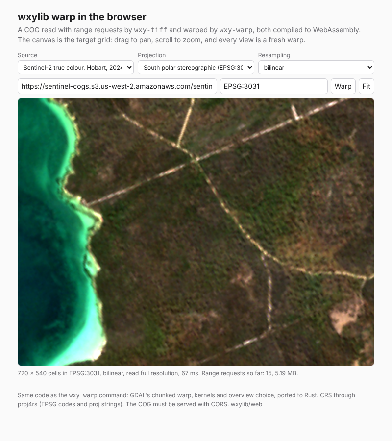

# wxylib/web

wxylib in the browser. A Cloud Optimized GeoTIFF is opened over HTTP range
requests by `wxy-tiff` and warped by `wxy-warp`, both compiled to
WebAssembly, onto the canvas. The canvas is the target grid: drag to pan,
scroll to zoom, and every view is a fresh warp with the same code the
`wxy warp` command runs (GDAL's chunked warp, kernels and overview choice).
Rendering is warping to a screen grid.


A Sentinel-2 true colour scene over Hobart (UTM 55S) on south polar
stereographic: 144 ms for the warp, five range requests (header, image
directories and the coarsest overview's tiles, 0.74 MB). Zoomed in, the
warp switches to full resolution as gdalwarp's `-ovr AUTO` would, and
fetches only the tiles the view touches:



## What is in it

- `src/fetch.rs`: an async-tiff reader over the browser's `fetch` with
  `Range` headers, caching each range, so panning re-reads tiles from
  memory.
- `src/render.rs`: the view (CRS, extent, size, resampling), the overview
  choice and the warp, as `f32` planes with `NaN` for nothing. No
  JavaScript here, so it is tested natively against wxylib/fixtures.
- `src/lib.rs`: the wasm surface, one class:

  ```js
  import init, { Cog } from "./pkg/wxy_web.js";
  await init();
  const cog = await Cog.open(url);          // server must allow CORS
  JSON.parse(cog.info());                   // size, bands, dtype, crs, overviews
  cog.bounds("EPSG:3031");                  // source extent in a CRS
  const out = await cog.warp("EPSG:3031", [xmin, xmax, ymin, ymax], 720, 540, "bilinear");
  // out.values: Float32Array, band by band; out.bands, out.level,
  // out.requests, out.bytes
  ```

- `www/`: the page. Colouring is in JavaScript (percentile stretch; a
  sea and land ramp when values straddle zero, viridis otherwise, RGB for
  three bands). While dragging it warps at half size with nearest
  neighbour, then once more at full size when the view settles.

Sources in the menu: two synthetic wxylib/fixtures COGs (served by
raw.githubusercontent.com, which allows CORS and ranges) and a Sentinel-2
scene from the `sentinel-cogs` bucket. Any CORS-enabled COG URL works, and
`?url=...&crs=...` opens one directly.

CRS is proj4rs, pure Rust: EPSG codes and proj strings for the projections
it implements (stere, laea, merc, moll, geos, lcc, tmerc and more), no
datum grids. Two gaps found while building this: `+proj=laea` at a pole
(`+lat_0=-90`) maps nothing, and `+proj=aeqd` is not registered. proj-wasm
is the planned route to full PROJ (design gate 4).

## Build and run

```sh
rustup target add wasm32-unknown-unknown
cargo install wasm-bindgen-cli --version 0.2.129   # the version in Cargo.lock
scripts/build.sh                                   # -> www/pkg/
python3 -m http.server -d www 8000                 # open http://localhost:8000/
```

clang is needed for zstd's C code. `cargo test` runs the native tests; they
look for wxylib/fixtures at `../fixtures` or `$WXY_FIXTURES` and skip
without it.

wxylib/core is pinned by git rev in `Cargo.toml`; bump it there.

## Not yet

- The warp runs on the page's thread. Moving it to a worker keeps the
  page responsive on big views.
- Zarr: `wxy-zarr` does not build for wasm until `ChunkSource` drops its
  `Send`/`Sync` bound there (design doc 03, section 5). Virtual stores
  (Icechunk) are further off.
- One source band set, one view; no tile pyramid, no overlay of vectors.

New to wxylib? The [intro page](https://github.com/wxylib/docs#readme)
says what works today. Design and roadmap:
[wxylib/design](https://github.com/wxylib/design).

License: MIT OR Apache-2.0.
